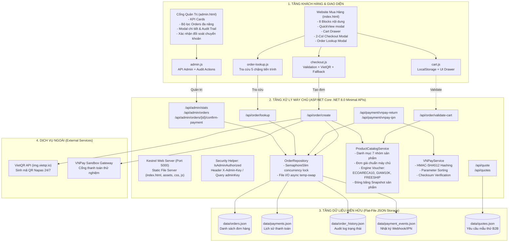
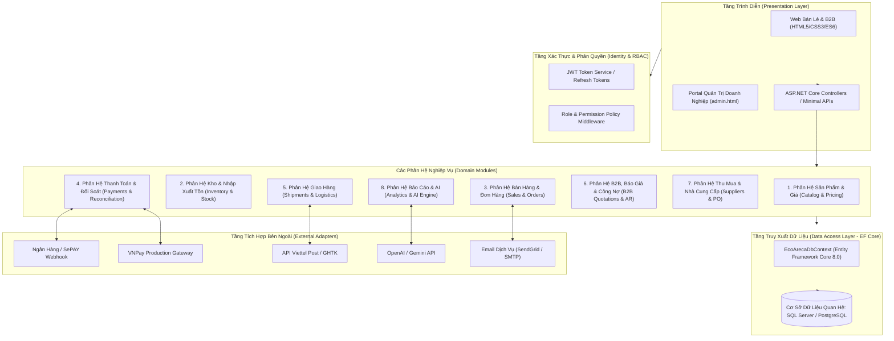
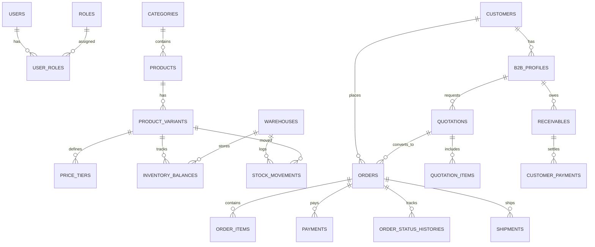
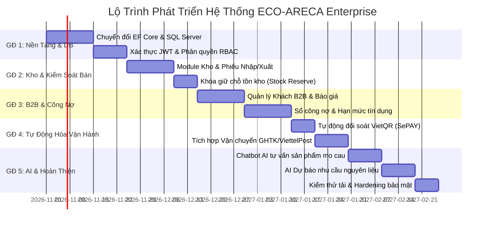

# 🌿 ECO-ARECA — BÁO CÁO TOÀN DIỆN: AUDIT HỆ THỐNG & LỘ TRÌNH PHÁT TRIỂN DOANH NGHIỆP
*(Enterprise Development Audit & Roadmap — Phase 1: Read-Only Analysis & Strategic Planning)*

---

## MỤC 1 — TÓM TẮT HIỆN TRẠNG HỆ THỐNG

| Tiêu chí | Hiện trạng thực tế tại Source Code | Bằng chứng kiểm tra |
| :--- | :--- | :--- |
| **Công nghệ & Runtime** | C# 12, **.NET 8.0 Web SDK** (`net8.0`), ASP.NET Core Minimal APIs. | `EcoAreca.csproj` |
| **Kiến trúc ứng dụng** | **Single-Project Monolith** kết hợp phục vụ Static Files & RESTful Minimal API trên cùng tiến trình Kestrel port `5000`. | `Program.cs` |
| **Frontend UI/UX** | Vanilla HTML5, CSS3 Variables, ES6 JavaScript Modules (Không dùng React/Vue, không dùng Tailwind CSS). | `index.html`, `admin.html` |
| **Cơ chế lưu trữ dữ liệu** | **File-based JSON Repository** đa luồng an toàn qua `SemaphoreSlim(1,1)` ghi vào thư mục `data/` (`orders.json`, `payments.json`, `order_history.json`, `payment_events.json`, `quotes.json`). Chưa có RDBMS / EF Core. | `Services/OrderRepository.cs` |
| **Bảo mật & Phân quyền** | Xác thực Admin qua Header `X-Admin-Key` hoặc Query string `adminKey` (`EcoAreca@Admin2026`). Chưa có bảng User, chưa có JWT/Identity, chưa có RBAC. | `Program.cs` |
| **Trạng thái E-commerce** | Hoạt động đầy đủ từ Giỏ hàng $\rightarrow$ Tính giá server $\rightarrow$ Checkout $\rightarrow$ COD / VietQR / VNPay Sandbox $\rightarrow$ Tra cứu đơn 5 bước $\rightarrow$ Bảng quản trị Admin. | `js/checkout.js`, `js/order-lookup.js` |
| **Những hạn chế lớn nhất** | 1. Chưa có quản lý tồn kho (Inventory/Stock movement) — Sản phẩm bán không giới hạn số lượng. 2. Chưa có module B2B phân cấp (bảng giá sỉ, hạn mức công nợ, quản lý đại lý). 3. Chưa kết nối RDBMS (SQL Server/PostgreSQL), tiềm ẩn nút thắt cổ chai I/O khi đạt quy mô doanh nghiệp. 4. Quản trị phân quyền đơn cấp (1 API Key duy nhất, không tách vai trò Kế toán, Kho, Bán hàng). | Toàn bộ mã nguồn |

---

## MỤC 2 — SƠ ĐỒ KIẾN TRÚC HIỆN TẠI

---

## MỤC 3 — BẢNG ĐÁNH GIÁ CHỨC NĂNG CHI TIẾT

| Module / Chức năng | Trạng thái thực tế | Bằng chứng từ Source Code | Vấn đề & Khoảng trống nghiệp vụ | Mức ưu tiên |
| :--- | :--- | :--- | :--- | :--- |
| **Trang chủ & Giới thiệu** | **Đã xác minh hoạt động** | `index.html` (L31-L900) | Nội dung tĩnh, chưa có hệ thống CMS quản lý bài viết/banner từ admin. | P3 |
| **Danh mục sản phẩm** | **Đã xác minh hoạt động** | `ProductCatalogService.cs` (L28-L129), `products.js` (L7-L135) | Danh mục fix cứng trong code C# và file JS, chưa quản lý trong DB động. | P1 |
| **Giỏ hàng trượt (Cart Drawer)** | **Đã xác minh hoạt động** | `cart.js` (L1-L299) | Lưu ở client `localStorage`. Chưa đồng bộ giỏ hàng khi khách đổi thiết bị. | P2 |
| **Tính giá & Mã giảm giá** | **Đã xác minh hoạt động** | `ProductCatalogService.cs` (L142-L257) | Mã voucher hardcode trong mã nguồn, chưa có ngày hết hạn và hạn mức số lần dùng. | P1 |
| **Tạo đơn hàng & COD** | **Đã xác minh hoạt động** | `Program.cs` (L87-L217) | Không kiểm tra tồn kho khi tạo đơn (có thể bán âm không giới hạn). | **P0** |
| **Chuyển khoản VietQR** | **Đã xác minh hoạt động** | `Program.cs` (L179-L196), `checkout.js` (L338-L380) | Cần quản trị viên bấm đối soát bằng tay, chưa có webhook tự động nhận tiền ngân hàng (Casso/SePAY). | P2 |
| **Cổng VNPay Sandbox** | **Đã xác minh hoạt động** | `VNPayService.cs` (L1-L155), `Program.cs` (L329-L394) | Đang dùng Terminal Sandbox `ECOARECA`. Cần hợp đồng thương mại và Secret Key thật. | P1 |
| **Tra cứu đơn hàng** | **Đã xác minh hoạt động** | `order-lookup.js` (L1-L299), `Program.cs` (L222-L274) | Tra cứu tốt theo Mã đơn + SĐT. Chưa có tài khoản đăng nhập để xem lịch sử tích lũy. | P2 |
| **Bảng quản trị Admin** | **Đã xác minh hoạt động** | `admin.html` (L1-L301), `admin.js` (L1-L490) | Dùng chung 1 API Key tĩnh. Không phân quyền nhân viên kho / kế toán / sales. | **P0** |
| **Quản lý kho (Inventory)** | **Chưa triển khai** | Không có entity hoặc logic nào | Chưa có bảng tồn kho, phiếu nhập/xuất kho, lịch sử biến động, cảnh báo tồn tối thiểu. | **P0** |
| **Báo giá & Khách hàng B2B** | **Mới có một phần** | `form-handler.js` (L1-L162), `Program.cs` (L495-L534) | Mới tiếp nhận thông tin vào `quotes.json`. Chưa có tạo báo giá, bảng giá sỉ, duyệt giá, hợp đồng. | P1 |
| **Quản lý công nợ (AR/AP)** | **Chưa triển khai** | Không có entity hoặc logic nào | Chưa theo dõi công nợ nhà hàng, hạn mức tín dụng, kỳ hạn thanh toán 15/30 ngày. | P1 |
| **Tích hợp hãng vận chuyển** | **Mới có một phần** | `OrderModels.cs` (L33-L37) (phí fix 25.000đ) | Chưa kết nối API GHTK/GHN/Viettel Post để đẩy vận đơn và lấy tracking thực tế. | P2 |
| **AI tư vấn & phân tích** | **Chưa triển khai** | Không có code hoặc tích hợp | Chưa có chatbot tư vấn quy cách mo cau, chưa có dự báo nhu cầu nguyên liệu mo cau. | P3 |

---

## MỤC 4 — ĐÁNH GIÁ DATABASE & TÍNH TOÀN VẸN DỮ LIỆU

### 1. Cấu trúc lưu trữ hiện tại
Hệ thống sử dụng cơ chế **Flat-file JSON Repository** được đồng bộ qua `SemaphoreSlim(1, 1)` và kỹ thuật ghi file tạm `.tmp` rồi hoán đổi nguyên tử (`File.Move(tempFile, filePath, overwrite: true)`):
- `data/orders.json`: Lưu thông tin đơn hàng, địa chỉ, tổng tiền, trạng thái và mảng snapshot `Items`.
- `data/payments.json`: Lưu bản ghi thanh toán tương ứng với từng đơn hàng.
- `data/order_history.json`: Lưu nhật ký chuyển đổi trạng thái đơn hàng (`OrderStatusHistory`).
- `data/payment_events.json`: Lưu lịch sử phản hồi thô từ các webhook thanh toán.
- `data/quotes.json`: Lưu thông tin đăng ký mẫu thử/báo giá sỉ B2B.

### 2. Điểm mạnh đã đạt được
- **Đóng băng Snapshot giá & sản phẩm**: `OrderItem` lưu độc lập `ProductNameSnapshot`, `VariantSnapshot`, `UnitPriceSnapshot`. Khi giá bán hoặc tên sản phẩm sau này thay đổi, các đơn hàng quá khứ không bị sai lệch số liệu doanh thu.
- **Tách biệt trạng thái**: Tách rạch ròi giữa `OrderStatus` (`PendingConfirmation`, `Confirmed`, `Processing`, `Shipping`, `Completed`, `Cancelled`) và `PaymentStatus` (`Pending`, `Paid`, `Failed`, `Cancelled`).
- **An toàn tương đối khi đơn luồng**: Semaphore ngăn chặn được hiện tượng hai thread cùng ghi đè file làm hỏng cấu trúc JSON.

### 3. Rủi ro toàn vẹn & Điểm nghẽn kiến trúc (Database Bottlenecks)
1. **Thiếu tính nguyên tử phân tán (Distributed ACID Transactions)**: Nếu quá trình ghi `orders.json` thành công nhưng máy chủ mất điện hoặc crash trước khi ghi xong `payments.json`, dữ liệu sẽ bị mồ côi (Orphaned records) do không có cơ chế Rollback Transaction như RDBMS.
2. **Chi phí I/O tỷ lệ thuận với số lượng đơn (O(N) Read/Write)**: Mỗi lần thêm đơn hàng mới, hàm `ReadListAsync` phải đọc toàn bộ file JSON vào RAM, deserialize toàn bộ mảng, sau đó serialize và ghi đè toàn bộ file. Khi hệ thống đạt 10.000 đơn hàng (~5MB JSON), độ trễ mỗi request tạo đơn sẽ tăng vọt và gây nghẽn CPU.
3. **Không có Ràng buộc Khóa ngoại (Foreign Key Constraints)**: Không có cơ chế DB-level để bảo đảm `OrderItem.OrderId` luôn trỏ tới một `Order` hợp lệ, hoặc ngăn chặn việc xóa nhầm dữ liệu lịch sử.
4. **Không hỗ trợ truy vấn chỉ mục phức tạp (Indexing)**: Tìm kiếm đơn theo ngày, số điện thoại, trạng thái đều phải duyệt tuần tự (Table Scan trong RAM).

---

## MỤC 5 — DANH SÁCH VẤN ĐỀ CẦN XỬ LÝ (PHÂN LOẠI P0 $\rightarrow$ P3)

### Nhóm P0: Rủi ro nghiêm trọng về dữ liệu, bảo mật và tính đúng đắn giao dịch
- **P0-1: Chưa có quản lý tồn kho và chống bán vượt (Stock Overselling)**
  - *Bằng chứng*: `ProductCatalogService.cs` duyệt đơn mà không trừ tồn kho hay kiểm tra số lượng khả dụng.
  - *Hậu quả*: Khách hàng có thể đặt 1.000 chiếc dĩa trong khi xưởng chỉ còn 100 chiếc, gây vỡ cam kết giao hàng và ảnh hưởng uy tín thương hiệu.
- **P0-2: Lưu trữ File JSON đơn điểm (Single Point of Data Loss / Bottleneck)**
  - *Bằng chứng*: Toàn bộ đơn hàng nằm trong các file JSON cục bộ tại `data/`.
  - *Hậu quả*: Không có WAL (Write-Ahead Logging), nguy cơ mất dữ liệu khi ổ đĩa bị lỗi, không thể scale ngang (load balancing).
- **P0-3: Cơ chế xác thực Admin bằng khóa tĩnh (Hardcoded Static API Key)**
  - *Bằng chứng*: `Program.cs`, `appsettings.json`, `admin.js`.
  - *Hậu quả*: Bất kỳ ai xem được network request hoặc source code đều có thể gửi lệnh đổi trạng thái đơn, xác nhận thanh toán giả mạo.
- **P0-4: Thiếu kiểm soát luồng chuyển đổi trạng thái đơn (State Machine Enforcement)**
  - *Bằng chứng*: `Program.cs` cho phép gán trực tiếp bất kỳ `NewStatus` nào.
  - *Hậu quả*: Một đơn hàng đã `Cancelled` (Đã hủy) hoặc `Completed` (Đã hoàn thành) vẫn có thể bị gọi API chuyển ngược về `Processing`, gây sai lệch kế toán và vận hành.

### Nhóm P1: Vấn đề ảnh hưởng trực tiếp đến vận hành doanh nghiệp & B2B
- **P1-1: Danh mục sản phẩm và giá bị fix cứng trong mã nguồn (Hardcoded Catalog)**
  - *Bằng chứng*: `ProductCatalogService.cs`. Quản trị viên muốn tăng giá 500đ/sản phẩm phải mở code sửa và build lại toàn bộ ứng dụng.
- **P1-2: Chưa có module Báo giá B2B và Bảng giá theo số lượng (Tiered Wholesale Pricing)**
  - *Bằng chứng*: `form-handler.js` chỉ lưu contact. Chưa có tính giá chiết khấu cho nhà hàng đặt 5.000 chén mo cau/tháng.
- **P1-3: Chưa theo dõi Công nợ đại lý / nhà hàng (Accounts Receivable)**
  - *Bằng chứng*: Chưa có thực thể hóa đơn nợ, kỳ hạn 30 ngày, đối soát thanh toán từng phần.
- **P1-4: Chưa có quy trình Quản lý Mua hàng & Nhà cung cấp bẹ cau (Procurement & Supplier)**
  - *Bằng chứng*: Chưa ghi nhận chi phí thu gom bẹ cau thô, chi phí ép nhiệt, giá vốn thành phẩm (COGS).
- **P1-5: Secret Key thanh toán VNPay đang ở cấu hình Sandbox**
  - *Bằng chứng*: `appsettings.json` chứa thông tin thử nghiệm của VNPay, chưa kết nối tài khoản merchant chính thức.

### Nhóm P2: Chức năng mở rộng & Tối ưu luồng
- **P2-1: Tự động hóa đối soát ngân hàng VietQR**: Cần tích hợp webhook ngân hàng (Casso/SePAY) để tự động đổi trạng thái `Paid` trong 3 giây khi khách chuyển khoản thành công.
- **P2-2: Tích hợp API Đơn vị vận chuyển (GHTK/GHN/Viettel Post)**: Tạo mã vận đơn, in phiếu giao hàng, đồng bộ vị trí đơn tự động.
- **P2-3: Cổng tài khoản khách hàng (Customer Account Portal)**: Khách hàng đăng nhập bằng OTP SĐT hoặc Google để xem lịch sử mua hàng, địa chỉ đã lưu, điểm thưởng sinh thái.
- **P2-4: Engine Khuyến mãi & Voucher động**: Quản lý mã giảm giá có giới hạn số lượng, thời gian bắt đầu/kết thúc, phân loại theo đơn tối thiểu.

### Nhóm P3: Tối ưu nâng cao & Ứng dụng AI
- **P3-1: Chatbot AI tư vấn quy cách sản phẩm**: Hỗ trợ khách chọn kích thước dĩa, độ chịu nhiệt của mo cau, tư vấn set tiệc theo số lượng người.
- **P3-2: AI dự báo nhu cầu nguyên liệu mo cau**: Dự báo sản lượng bẹ cau cần thu mua tại các vùng nguyên liệu (Quảng Nam, Bình Định, Thừa Thiên Huế) theo mùa vụ.
- **P3-3: Hệ thống logging tập trung & Giám sát lỗi**: Tích hợp Serilog + Seq / Application Insights thay cho `Console.WriteLine`.

---

## MỤC 6 — KIẾN TRÚC MỤC TIÊU: MODULAR MONOLITH

Nhằm đảm bảo tiêu chí **bảo toàn framework .NET 8.0 hiện tại**, không làm phức tạp hóa hạ tầng bằng microservices khi chưa cần thiết, kiến trúc tối ưu nhất cho ECO-ARECA là **Modular Monolith** phân tầng rõ ràng theo miền nghiệp vụ:

---

## MỤC 7 — MÔ HÌNH DỮ LIỆU DOANH NGHIỆP MỤC TIÊU

### Các nhóm thực thể chính:
1. **Catalog & Pricing**: `Categories`, `Products`, `ProductVariants`, `PriceTiers` (bảng giá số lượng).
2. **Inventory & Warehouse**: `Warehouses`, `InventoryBalances` (Tồn thực tế, Tồn giữ chỗ, Tồn khả dụng $\ge 0$), `StockMovements` (Lịch sử biến động xuất/nhập/kiểm kê/hủy).
3. **B2B & Quotations**: `Customers`, `B2BProfiles` (Mã số thuế, mô hình F&B, hạn mức nợ, kỳ hạn 15/30 ngày), `Quotations`, `QuotationItems`.
4. **Orders & Payments**: `Orders`, `OrderItems` (Snapshot độc lập), `Payments`, `OrderStatusHistories`, `PaymentEvents`.
5. **Security & RBAC**: `Users`, `Roles`, `UserRoles`, `Permissions`.

---

## MỤC 8 — LỘ TRÌNH PHÁT TRIỂN (ENTERPRISE ROADMAP)

---

## MỤC 9 — DANH SÁCH TÍCH HỢP NGOÀI

| Tích hợp | Giá trị nghiệp vụ | Trạng thái hiện tại | Điều kiện & Tài khoản cần có | Cơ chế dự phòng khi lỗi |
| :--- | :--- | :--- | :--- | :--- |
| **VietQR (Napas)** | Sinh mã QR động chuẩn ngân hàng có sẵn số tiền và mã đơn. | **Đã hoạt động thực tế** | Sử dụng API mở `img.vietqr.io`. Miễn phí, không cần hợp đồng. | Hiển thị thông tin chuyển khoản dạng chữ kèm nút copy 1 chạm. |
| **Đối soát ngân hàng tự động (SePAY/Casso)** | Tự động nhận diện biến động số dư và duyệt đơn `Paid` trong 3 giây. | **Chưa tích hợp** | Tài khoản SePAY/Casso + Tài khoản ngân hàng MB/VCB doanh nghiệp. Phí ~100k-200k/tháng. | Quản trị viên đối soát thủ công trên `admin.html` (đã có sẵn). |
| **Cổng VNPay** | Thanh toán thẻ ATM nội địa, thẻ quốc tế Visa/Master, VNPAY-QR. | **Đang chạy Sandbox** | Hợp đồng Merchant doanh nghiệp với VNPay để cấp TMN Code & Hash Secret Production. | Hướng dẫn khách chuyển sang Chuyển khoản VietQR hoặc COD. |
| **Hãng vận chuyển (GHTK / Viettel Post)** | Tính phí ship theo tọa độ, tự động đẩy đơn, sinh mã vận đơn bưu cục. | **Chưa tích hợp** | Ký hợp đồng dịch vụ chuyển phát + API Token của đối tác. | Áp dụng mức phí ship đồng giá nội bộ (25.000đ, freeship >= 300k). |
| **Email giao dịch (SendGrid / Brevo)** | Gửi email hóa đơn điện tử, thông báo trạng thái đơn hàng và hợp đồng B2B. | **Chưa tích hợp** | Đăng ký tài khoản SendGrid hoặc dịch vụ SMTP cấu hình trong `appsettings.json`. | Thông báo qua màn hình Tra cứu đơn hàng trên web hoặc Zalo/SMS. |
| **AI LLM API (Google Gemini / OpenAI)** | Trợ lý tư vấn sản phẩm chén dĩa mo cau và phân tích kinh doanh. | **Chưa tích hợp** | API Key Google AI Studio hoặc OpenAI Platform; thẻ thanh toán quốc tế. | Chatbot trả lời theo các kịch bản FAQ mẫu dựng sẵn (Rule-based). |

---

## MỤC 10 — CHIẾN LƯỢC ỨNG DỤNG AI

1. **Chatbot AI tư vấn sản phẩm sinh thái (RAG Knowledge Engine)**:
   - Tư vấn khách hàng về khả năng chịu nhiệt (-20°C đến 120°C), tính an toàn trong lò vi sóng (2-3 phút), tốc độ phân hủy (45-60 ngày).
   - Tuyệt đối không bịa đặt chứng nhận khi chưa có kiểm định chính thức.
2. **AI Trợ lý Quản trị (Admin Copilot)**:
   - Hỗ trợ giám đốc truy vấn số liệu kinh doanh qua ngôn ngữ tự nhiên.
   - Chỉ biên dịch câu hỏi thành các API định sẵn có quyền đọc; không cho phép AI chạy SQL trực tiếp.
3. **AI Dự báo Nhu cầu Nguyên liệu (Supply Forecasting)**:
   - Dự báo lượng bẹ cau cần thu mua trước mùa mưa bão tại miền Trung dựa trên xu hướng bán hàng.

---

## MỤC 11 — KẾ HOẠCH KIỂM THỬ VÀ NGHIỆM THU DOANH NGHIỆP

1. **Kiểm thử Concurrency Kho**: Giả lập 20 request đồng thời mua 5 sản phẩm cuối cùng $\rightarrow$ Đảm bảo chỉ đúng 5 đơn thành công, không âm kho.
2. **Kiểm thử Chống gian lận giá**: Can thiệp client sửa đơn giá 0đ $\rightarrow$ Server từ chối ngay với HTTP 400.
3. **Kiểm thử Webhook Idempotency**: Gửi lặp IPN thanh toán 5 lần $\rightarrow$ Chỉ xác nhận và ghi nhận doanh thu đúng 1 lần.
4. **Kiểm thử Phân quyền (RBAC)**: Nhân viên kho không thể xóa đơn hoặc duyệt tiền; nhân viên sales không thể xem chi phí giá vốn.

---

## MỤC 12 — KẾ HOẠCH THỰC HIỆN TIẾP THEO (CÁC PROMPT ĐỘC LẬP)

* **Prompt Giai đoạn 1**: *"Triển khai EF Core 8.0 kết nối SQL Server/PostgreSQL, chuyển đổi dữ liệu từ data/*.json sang cơ sở dữ liệu quan hệ và xây dựng xác thực JWT Token cho Quản trị viên theo Kiến trúc Modular Monolith."*
* **Prompt Giai đoạn 2**: *"Xây dựng phân hệ Quản lý Kho Hàng (Inventory): Thêm bảng tồn kho, phiếu nhập/xuất kho, cơ chế khóa giữ chỗ (Stock Reservation) và kiểm tra tồn khả dụng tự động khi đặt hàng qua API /api/order/create."*
* **Prompt Giai đoạn 3**: *"Xây dựng phân hệ Khách hàng Doanh nghiệp B2B: Bảng giá đại lý phân tầng (Tiered Pricing), quy trình tạo và duyệt báo giá (Quotation Flow), theo dõi sổ công nợ và hạn mức tín dụng 30 ngày."*
* **Prompt Giai đoạn 4**: *"Tích hợp Webhook đối soát chuyển khoản ngân hàng tự động 24/7 (SePAY/Casso) và tích hợp API đẩy vận đơn tự động với đơn vị vận chuyển."*
* **Prompt Giai đoạn 5**: *"Tích hợp Chatbot AI tư vấn kỹ thuật sản phẩm chén dĩa mo cau và Trợ lý AI báo cáo quản trị kinh doanh trên nền tảng RAG."*

---

## MỤC 13 — CÁC QUYẾT ĐỊNH CẦN NGƯỜI DÙNG XÁC NHẬN

1. **Cơ sở dữ liệu**: Lựa chọn **Microsoft SQL Server** hay **PostgreSQL**?
2. **Quy mô kho**: Vận hành 1 Kho tổng tại Xưởng Huế hay dự kiến mở Kho Hà Nội & TP. HCM?
3. **Bán nợ B2B**: Có áp dụng chính sách công nợ 15/30 ngày cho nhà hàng/resort không?
4. **Đối tác vận chuyển**: Ưu tiên Viettel Post, GHTK hay GHN?
5. **Ngân hàng đối soát**: Doanh nghiệp dùng ngân hàng nào (MB Bank, Vietcombank, ACB...)?
