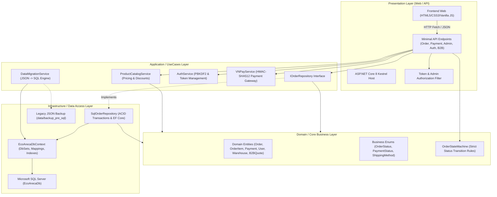
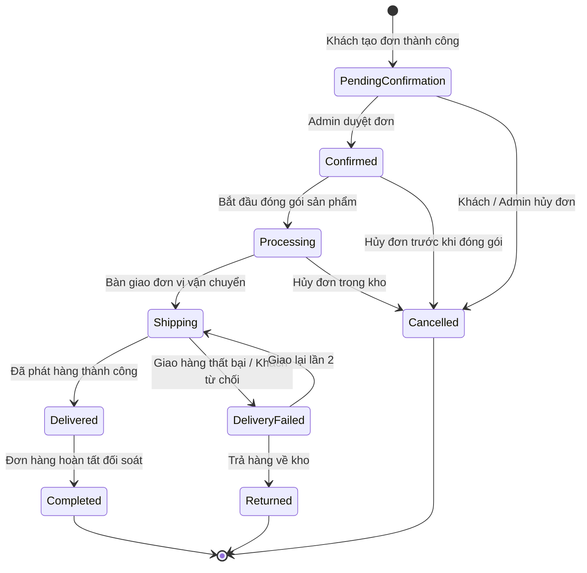

# ECO-ARECA — TÀI LIỆU THIẾT KẾ KIẾN TRÚC HỆ THỐNG (ARCHITECTURE)
**Dự án:** ECO-ARECA E-Commerce Platform  
**Phiên bản kiến trúc:** 2.0 (Phase 1 Refactored)  
**Mô hình kiến trúc:** Pragmatic Clean Architecture / Modular Monolith  
**Nền tảng:** .NET 8.0 Minimal APIs, Entity Framework Core 8.0, Microsoft SQL Server 2022  

---

## 1. TỔNG QUAN VÀ CHIẾN LƯỢC THIẾT KẾ

Để đáp ứng mục tiêu **không phá vỡ website hiện tại**, nâng cấp từng bước vững chắc từ mô hình Single-File JSON sang hệ thống cấp doanh nghiệp, hệ thống áp dụng mô hình **Modular Monolith** kết hợp nguyên lý **Clean Architecture**.

---

## 2. PHÂN TẦNG VÀ NGUYÊN TẮC PHỤ THUỘC (DEPENDENCY RULES)

Hệ thống tuân thủ nghiêm ngặt nguyên lý đảo ngược phụ thuộc (Dependency Inversion Principle - DIP):

### 2.1. Tầng Domain (Core Business)
- **Vị trí:** `Models/OrderModels.cs`
- **Nội dung:** 
  - Thực thể nghiệp vụ thuần túy: `Order`, `OrderItem`, `Payment`, `OrderStatusHistory`, `PaymentEvent`, `User`, `Warehouse`, `ProductInventory`, `StockMovement`, `B2BQuote`.
  - Các Enum nghiệp vụ: `OrderStatus`, `PaymentStatus`, `ShippingMethod`.
  - Quy tắc nghiệp vụ cốt lõi: `OrderStateMachine` quản lý vòng đời đơn hàng, xác định các bước chuyển trạng thái hợp lệ.
- **Ràng buộc:** Không phụ thuộc vào bất kỳ framework truy cập dữ liệu hay thư viện ngoài nào (POCO).

### 2.2. Tầng Application (Use Cases & Interfaces)
- **Vị trí:** `Services/IOrderRepository.cs`, `Services/ProductCatalogService.cs`, `Services/AuthService.cs`, `Services/VNPayService.cs`
- **Nội dung:**
  - Định nghĩa hợp đồng repository: `IOrderRepository` trừu tượng hóa các tác vụ tạo đơn, tra cứu, đối soát thanh toán và cập nhật trạng thái.
  - Xử lý nghiệp vụ tính giá, kiểm tra voucher, mã giảm giá máy chủ (`ProductCatalogService`).
  - Quản lý mã hóa mật khẩu PBKDF2 và vòng đời token đăng nhập (`AuthService`).
  - Đóng gói logic ký số HMAC-SHA512 và xác thực webhook cổng thanh toán (`VNPayService`).
- **Ràng buộc:** Chỉ phụ thuộc vào tầng Domain.

### 2.3. Tầng Infrastructure (Data Access & Persistence)
- **Vị trí:** `Data/EcoArecaDbContext.cs`, `Services/SqlOrderRepository.cs`, `Services/DataMigrationService.cs`
- **Nội dung:**
  - Triển khai `EcoArecaDbContext` kế thừa từ `Microsoft.EntityFrameworkCore.DbContext`. Cấu hình Schema, Precision `decimal(18,2)`, Foreign Keys và Index chuyên biệt cho SQL Server.
  - Triển khai `SqlOrderRepository` hiện thực hóa `IOrderRepository`, bọc các thao tác ghi dữ liệu đa thực thể vào ACID Transaction (`BeginTransactionAsync`).
  - Triển khai `DataMigrationService` tự động kiểm tra, làm sạch và nạp dữ liệu cũ từ JSON vào SQL Server khi khởi động hệ thống.
- **Ràng buộc:** Triển khai các interface từ tầng Application và phụ thuộc Domain.

### 2.4. Tầng Presentation / Web API (Composition Root)
- **Vị trí:** `Program.cs`, `wwwroot/` (`index.html`, `admin.html`, `js/`)
- **Nội dung:**
  - Định cấu hình Dependency Injection (DI Container): đăng ký vòng đời Scoped cho `EcoArecaDbContext` và `IOrderRepository`, Singleton cho `ProductCatalogService`, `AuthService`, `VNPayService`.
  - Expose các Minimal API RESTful endpoints với Authoritative Server Validation.
  - Bộ lọc xác thực `IsAdminAuthorized` bảo vệ toàn diện các endpoint quản trị.

---

## 3. ORDER STATE MACHINE & QUY TRÌNH CHUYỂN TRẠNG THÁI

Hệ thống triển khai máy trạng thái hữu hạn (Deterministic Finite State Machine) tại `OrderStateMachine.cs`:

### Bảng Chuyển Trạng Thái Được Phép:
| Trạng thái hiện tại | Các trạng thái kế tiếp hợp lệ | Mô tả nghiệp vụ |
|---|---|---|
| `PendingConfirmation` (0) | `Confirmed` (1), `Cancelled` (7) | Chờ xác nhận $\rightarrow$ Duyệt đơn hoặc Hủy đơn |
| `Confirmed` (1) | `Processing` (2), `Cancelled` (7) | Đã xác nhận $\rightarrow$ Đóng gói hoặc Hủy |
| `Processing` (2) | `Shipping` (3), `Cancelled` (7) | Đang xử lý $\rightarrow$ Xuất kho giao hoặc Hủy |
| `Shipping` (3) | `Delivered` (4), `DeliveryFailed` (5) | Đang giao $\rightarrow$ Đã phát hàng hoặc Giao thất bại |
| `Delivered` (4) | `Completed` (6) | Đã giao $\rightarrow$ Khách nhận ưng ý, hoàn tất đơn |
| `DeliveryFailed` (5) | `Shipping` (3), `Returned` (8) | Giao thất bại $\rightarrow$ Giao lại hoặc Trả về kho |
| `Completed` (6) | *(Terminal)* | Trạng thái kết thúc, không được sửa đổi |
| `Cancelled` (7) | *(Terminal)* | Trạng thái kết thúc, giải phóng tồn giữ chỗ |
| `Returned` (8) | *(Terminal)* | Hàng đã nhập lại kho sau khi trả về |

---

## 4. BẢO MẬT HỆ THỐNG (APPLICATION SECURITY SPECIFICATIONS)

1. **Chuẩn mã hóa Mật khẩu:** PBKDF2 (`KeyDerivation.Pbkdf2`) sử dụng `HMACSHA256`, độ dài muối ngẫu nhiên 128-bit (`RandomNumberGenerator`), số vòng lặp băm: `100,000` iterations, độ dài khóa đầu ra: 256-bit (32 bytes).
2. **Cơ chế Token Phiên:** Mã hex an toàn 256-bit tiền tố `eco_` sinh bởi `RandomNumberGenerator.GetBytes(32)`. Thời hạn hết hạn 24 giờ.
3. **Chống giả mạo thanh toán:**
   - VietQR: Mã đơn hàng độc nhất gắn liền nội dung chuyển khoản `ECO <OrderCode>`. Đối soát đối chiếu chính xác số tiền nợ.
   - VNPay: Khóa bí mật `vnp_HashSecret` sử dụng thuật toán HMAC-SHA512. Mọi gói tin webhook không khớp chữ ký đều bị từ chối với mã 97.
4. **Bảo toàn dữ liệu tài chính:** Tiền tệ trong toàn bộ hệ thống sử dụng kiểu `decimal` trong C# và `decimal(18,2)` trong SQL Server, loại bỏ hoàn toàn sai số làm tròn số thực dấu phẩy động (`float`/`double`).
