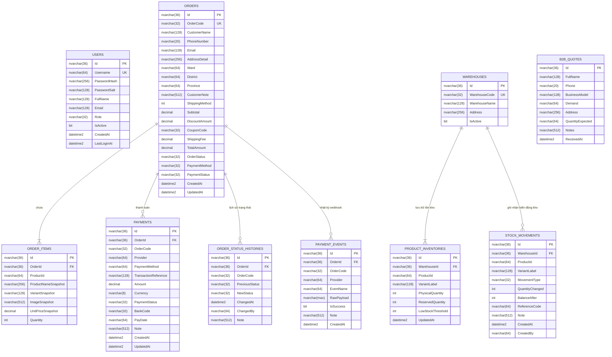

# ECO-ARECA — THIẾT KẾ CƠ SỞ DỮ LIỆU SQL SERVER (DATABASE DESIGN)
**Dự án:** ECO-ARECA E-Commerce Platform  
**Hệ quản trị CSDL:** Microsoft SQL Server 2022 / Azure SQL Database  
**ORM:** Microsoft Entity Framework Core 8.0  
**Tên Database:** `EcoArecaDb`  
**Collation:** `SQL_Latin1_General_CP1_CI_AS` (Hỗ trợ Unicode chuẩn tiếng Việt UTF-8/NVARCHAR)  

---

## 1. SƠ ĐỒ QUAN HỆ THỰC THỂ (ERD)

---

## 2. TỪ ĐIỂN DỮ LIỆU CHI TIẾT (DATA DICTIONARY)

### 2.1. Bảng `Orders` (Đơn hàng)
Lưu thông tin tổng quan, thông tin khách hàng, số tiền và trạng thái đơn hàng.
| Tên cột | Kiểu dữ liệu | Ràng buộc | Chỉ mục (Index) | Mô tả & Ý nghĩa |
|---|---|---|---|---|
| `Id` | `nvarchar(36)` | PK, NOT NULL | Clustered PK | Khóa chính dạng GUID 36 ký tự |
| `OrderCode` | `nvarchar(32)` | NOT NULL, UNIQUE | `IX_Orders_OrderCode` (Unique) | Mã đơn hàng công khai (`ECO-YYMMDD-XXXX`) |
| `CustomerName` | `nvarchar(128)` | NOT NULL | - | Họ tên người nhận hàng |
| `PhoneNumber` | `nvarchar(20)` | NOT NULL | `IX_Orders_PhoneNumber` | Số điện thoại nhận hàng (dùng tra cứu) |
| `Email` | `nvarchar(128)` | NOT NULL | - | Email khách hàng |
| `AddressDetail` | `nvarchar(256)` | NOT NULL | - | Địa chỉ giao hàng chi tiết |
| `Ward` | `nvarchar(64)` | NOT NULL | - | Phường / Xã |
| `District` | `nvarchar(64)` | NOT NULL | - | Quận / Huyện |
| `Province` | `nvarchar(64)` | NOT NULL | - | Tỉnh / Thành phố |
| `CustomerNote` | `nvarchar(512)` | NOT NULL | - | Ghi chú của khách khi đặt |
| `ShippingMethod` | `int` | NOT NULL | - | 0: Tiêu chuẩn, 1: Hỏa tốc, 2: Nhận tại xưởng |
| `Subtotal` | `decimal(18,2)` | NOT NULL | - | Tổng tiền hàng trước chiết khấu (VND) |
| `DiscountAmount` | `decimal(18,2)` | NOT NULL | - | Tiền giảm giá từ Voucher (VND) |
| `CouponCode` | `nvarchar(32)` | NOT NULL | - | Mã voucher áp dụng (`ECOARECA10`,...) |
| `ShippingFee` | `decimal(18,2)` | NOT NULL | - | Phí vận chuyển máy chủ tính (VND) |
| `TotalAmount` | `decimal(18,2)` | NOT NULL | - | **Tổng tiền thanh toán cuối cùng (VND)** |
| `OrderStatus` | `nvarchar(32)` | NOT NULL | `IX_Orders_OrderStatus` | Enum string: PendingConfirmation, Confirmed,... |
| `PaymentMethod` | `nvarchar(32)` | NOT NULL | - | COD, BankTransfer, VNPay |
| `PaymentStatus` | `nvarchar(32)` | NOT NULL | `IX_Orders_PaymentStatus` | Pending, Paid, Failed, Refunded |
| `CreatedAt` | `datetime2` | NOT NULL | `IX_Orders_CreatedAt` (Desc) | Thời điểm tạo đơn hàng |
| `UpdatedAt` | `datetime2` | NOT NULL | - | Thời điểm cập nhật cuối cùng |

### 2.2. Bảng `OrderItems` (Chi tiết đơn hàng - Snapshot)
Đóng băng thông tin sản phẩm tại thời điểm chốt đơn, độc lập hoàn toàn với việc thay đổi giá trong tương lai.
| Tên cột | Kiểu dữ liệu | Ràng buộc | Chỉ mục (Index) | Mô tả |
|---|---|---|---|---|
| `Id` | `nvarchar(36)` | PK, NOT NULL | Clustered PK | GUID chi tiết mặt hàng |
| `OrderId` | `nvarchar(36)` | FK, NOT NULL | `IX_OrderItems_OrderId` | Khóa ngoại liên kết `Orders.Id` (Cascade Delete) |
| `ProductId` | `nvarchar(64)` | NOT NULL | `IX_OrderItems_ProductId` | Mã định danh sản phẩm (`chen-vuong-cham`,...) |
| `ProductNameSnapshot` | `nvarchar(256)` | NOT NULL | - | Tên sản phẩm đóng băng tại thời điểm mua |
| `VariantSnapshot` | `nvarchar(128)` | NOT NULL | - | Quy cách đóng băng (Ví dụ: "Set 10 chiếc") |
| `ImageSnapshot` | `nvarchar(512)` | NOT NULL | - | Đường dẫn ảnh sản phẩm thời điểm mua |
| `UnitPriceSnapshot` | `decimal(18,2)` | NOT NULL | - | Đơn giá đóng băng tại thời điểm mua (VND) |
| `Quantity` | `int` | NOT NULL | - | Số lượng mua (phải > 0) |

### 2.3. Bảng `Payments` (Giao dịch thanh toán)
| Tên cột | Kiểu dữ liệu | Ràng buộc | Chỉ mục (Index) | Mô tả |
|---|---|---|---|---|
| `Id` | `nvarchar(36)` | PK, NOT NULL | Clustered PK | GUID bản ghi thanh toán |
| `OrderId` | `nvarchar(36)` | FK, NOT NULL | `IX_Payments_OrderId` | Khóa ngoại liên kết đơn hàng |
| `OrderCode` | `nvarchar(32)` | NOT NULL | `IX_Payments_OrderCode` | Mã đơn hàng đối soát |
| `Provider` | `nvarchar(64)` | NOT NULL | - | COD, VietQR_BankTransfer, VNPay |
| `PaymentMethod` | `nvarchar(64)` | NOT NULL | - | Phương thức thanh toán |
| `TransactionReference`| `nvarchar(128)` | NOT NULL | `IX_Payments_TxnRef` | Mã giao dịch ngân hàng / cổng thanh toán |
| `Amount` | `decimal(18,2)` | NOT NULL | - | Số tiền thanh toán (VND) |
| `Currency` | `nvarchar(8)` | NOT NULL | - | Đơn vị tiền tệ (mặc định "VND") |
| `PaymentStatus` | `nvarchar(32)` | NOT NULL | - | Trạng thái: Pending, Paid, Failed, Refunded |
| `BankCode` | `nvarchar(32)` | NOT NULL | - | Mã ngân hàng chuyển khoản (MB, VCB,...) |
| `PayDate` | `nvarchar(64)` | NOT NULL | - | Thời gian thanh toán từ phía ngân hàng |
| `Note` | `nvarchar(512)` | NOT NULL | - | Ghi chú đối soát của admin |
| `CreatedAt` | `datetime2` | NOT NULL | - | Thời gian tạo giao dịch |
| `UpdatedAt` | `datetime2` | NOT NULL | - | Thời gian cập nhật giao dịch |

### 2.4. Bảng `Users` (Quản trị viên & Phân quyền)
| Tên cột | Kiểu dữ liệu | Ràng buộc | Chỉ mục (Index) | Mô tả |
|---|---|---|---|---|
| `Id` | `nvarchar(36)` | PK, NOT NULL | Clustered PK | GUID người dùng |
| `Username` | `nvarchar(64)` | NOT NULL, UNIQUE | `IX_Users_Username` (Unique) | Tên đăng nhập |
| `PasswordHash` | `nvarchar(256)` | NOT NULL | - | Chuỗi băm mật khẩu PBKDF2 (Base64) |
| `PasswordSalt` | `nvarchar(128)` | NOT NULL | - | Muối ngẫu nhiên 128-bit (Base64) |
| `FullName` | `nvarchar(128)` | NOT NULL | - | Họ tên hiển thị của quản trị viên |
| `Email` | `nvarchar(128)` | NOT NULL | - | Email liên lạc |
| `Role` | `nvarchar(32)` | NOT NULL | - | Vai trò (`Admin`, `Sales`, `Warehouse`) |
| `IsActive` | `bit` | NOT NULL | - | Cờ kích hoạt tài khoản |
| `CreatedAt` | `datetime2` | NOT NULL | - | Thời điểm tạo tài khoản |
| `LastLoginAt` | `datetime2` | NULL | - | Lần đăng nhập thành công gần nhất |

### 2.5. Bảng Kho hàng: `Warehouses`, `ProductInventories`, `StockMovements`
- **`Warehouses`**: Quản lý địa điểm kho (Mã kho, tên kho, địa chỉ). Đã seed kho mặc định: `WH-HUE` (Kho tổng Hương Thủy, Thừa Thiên Huế).
- **`ProductInventories`**: Quản lý tồn kho theo cặp `WarehouseId` + `ProductId` + `VariantLabel` (Có Unique Index kết hợp). Theo dõi `PhysicalQuantity` (Tồn vật lý), `ReservedQuantity` (Tồn giữ chỗ khi khách đặt nhưng chưa thanh toán/xuất kho), `LowStockThreshold` (Ngưỡng cảnh báo sắp hết hàng).
- **`StockMovements`**: Nhật ký biến động xuất nhập tồn (MovementType: `Import`, `Reserve`, `ReleaseReservation`, `Export`, `Adjustment`). Đảm bảo nguyên tắc kế toán kho: không bao giờ sửa trực tiếp số lượng tồn mà phải tạo chứng từ biến động.

### 2.6. Bảng `B2BQuotes` (Yêu cầu Báo giá Doanh nghiệp)
Lưu trữ các yêu cầu báo giá sỉ, gia công OEM/ODM, nhà hàng, xuất khẩu gửi từ form `/api/quote`.
Index tối ưu: `IX_B2BQuotes_Phone` và `IX_B2BQuotes_ReceivedAt`.

---

## 3. CHIẾN LƯỢC TỐI ƯU HÓA CHỈ MỤC (INDEXING STRATEGY)

1. **Tra cứu đơn hàng tốc độ cao:** 
   - `IX_Orders_OrderCode` (Unique Non-Clustered) phục vụ tra cứu chính xác theo mã đơn với độ phức tạp $O(1)$.
   - `IX_Orders_PhoneNumber` phục vụ tìm kiếm đơn hàng theo số điện thoại khách hàng.
2. **Bộ lọc danh sách quản trị (Admin Dashboard):**
   - `IX_Orders_CreatedAt` (Descending) tối ưu cho việc phân trang và sắp xếp đơn hàng mới nhất lên đầu.
   - `IX_Orders_OrderStatus` và `IX_Orders_PaymentStatus` tối ưu cho các bộ lọc trạng thái đơn hàng.
3. **Chống trùng lặp & Ràng buộc nghiệp vụ:**
   - `IX_Users_Username` (Unique) chống tạo trùng username.
   - `IX_ProductInventories_Composite` (Unique trên WarehouseId + ProductId + VariantLabel) chống trùng lặp dòng tồn kho.
