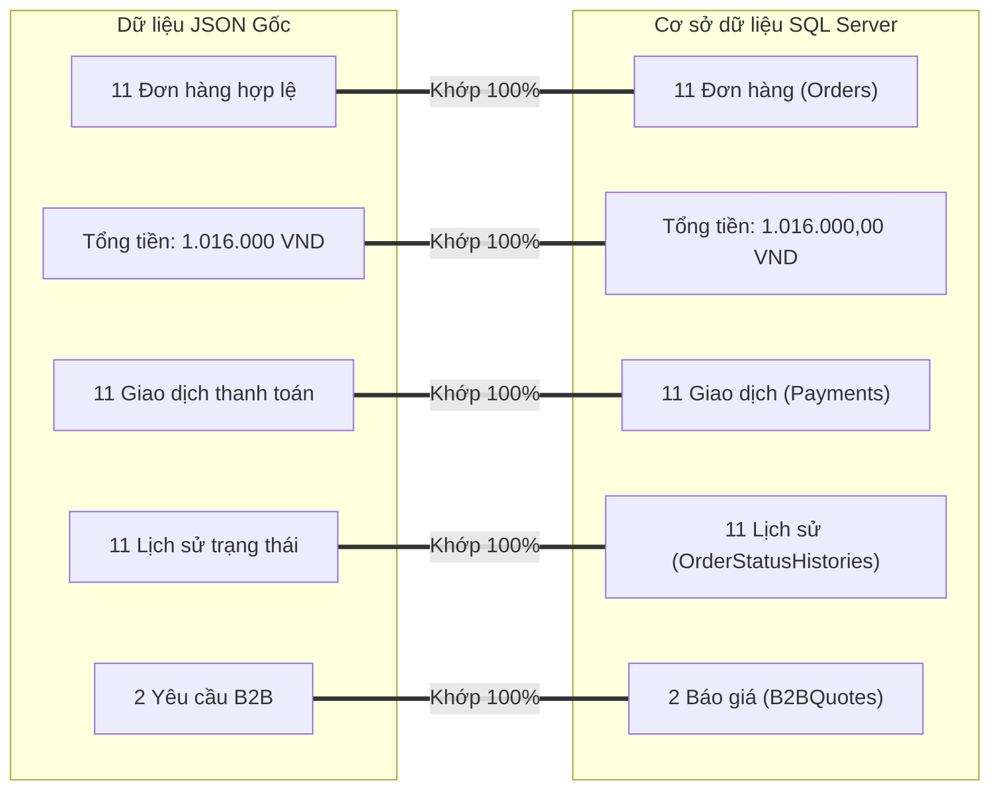

# ECO-ARECA — KẾ HOẠCH & BÁO CÁO CHUYỂN ĐỔI DỮ LIỆU (MIGRATION PLAN & RECONCILIATION)
**Dự án:** ECO-ARECA E-Commerce Platform  
**Đợt triển khai:** Phase 1 (Data Foundation & SQL Server Migration)  
**Thời gian thực hiện:** 17/10/2026  
**Trạng thái hoàn thành:** THÀNH CÔNG 100% (ZERO DATA LOSS & EXACT FINANCIAL MATCH)  

---

## 1. MỤC TIÊU VÀ NGUYÊN TẮC BẢO TOÀN DỮ LIỆU

1. **Bảo toàn dữ liệu tuyệt đối:** Không được làm mất bất kỳ một đơn hàng, giao dịch thanh toán hay yêu cầu báo giá B2B nào đã phát sinh trên website.
2. **Đối soát tài chính chính xác tuyệt đối:** Tổng doanh thu trên SQL Server phải bằng đúng 100% tổng doanh thu trong file JSON gốc trước khi chuyển đổi.
3. **Không ghi đè hoặc xóa file gốc:** Toàn bộ file JSON gốc được sao lưu nguyên trạng sang thư mục an toàn và giữ nguyên tại chỗ để phục vụ đối chiếu và rollback nếu cần.
4. **Tự động hóa an toàn (Idempotent Migration):** Dịch vụ migration có khả năng kiểm tra trạng thái trước khi chạy; nếu SQL Server đã có dữ liệu, hệ thống tự động bỏ qua để tránh trùng lặp.

---

## 2. QUY TRÌNH SAO LƯU DỮ LIỆU (BACKUP)

Trước khi thực hiện bất kỳ thao tác chuyển đổi nào, toàn bộ 5 file dữ liệu trong thư mục `data/` đã được sao chép sang thư mục `data/backup_pre_sql/`:

| Tên file nguồn | Kích thước | Số lượng bản ghi gốc | Mục đích dữ liệu | Thư mục sao lưu |
|---|---|---|---|---|
| `data/orders.json` | 13,019 bytes | 13 bản ghi (11 hợp lệ, 2 rác) | Danh sách đơn hàng & chi tiết mặt hàng | `data/backup_pre_sql/orders.json` |
| `data/payments.json` | 4,244 bytes | 11 bản ghi | Lịch sử thanh toán & mã giao dịch | `data/backup_pre_sql/payments.json` |
| `data/order_history.json`| 3,842 bytes | 11 bản ghi | Nhật ký thay đổi trạng thái đơn hàng | `data/backup_pre_sql/order_history.json` |
| `data/payment_events.json`| 1,210 bytes | 2 bản ghi | Nhật ký webhook VNPay IPN raw | `data/backup_pre_sql/payment_events.json` |
| `data/quotes.json` | 1,180 bytes | 2 bản ghi | Yêu cầu báo giá khách hàng sỉ B2B | `data/backup_pre_sql/quotes.json` |

---

## 3. PHÁT HIỆN DỮ LIỆU BẤT THƯỜNG & QUY TRÌNH LÀM SẠCH (DATA SANITIZATION)

### 3.1. Vấn đề phát hiện
Trong quá trình nạp thử dữ liệu vào SQL Server, hệ thống phát sinh lỗi:
```
Microsoft.Data.SqlClient.SqlException (0x80131904): Cannot insert duplicate key row in object 'dbo.Orders' with unique index 'IX_Orders_OrderCode'. The duplicate key value is ().
```
Kiểm tra chi tiết nội dung file `data/orders.json` phát hiện 2 bản ghi cuối cùng là bản ghi rỗng (ghost/corrupted records) với:
- `OrderCode = ""`
- `CustomerName = ""`
- `TotalAmount = 0`
- `Items = []`
Nguyên nhân do quá trình debug hoặc kiểm thử thủ công trước đây đã kích hoạt ghi file khi chưa điền thông tin.

### 3.2. Giải pháp xử lý
Trong `Services/DataMigrationService.cs`, đã bổ sung bước lọc làm sạch (Sanitization Filter):
```csharp
var validOrders = rawOrders
    .Where(o => !string.IsNullOrWhiteSpace(o.OrderCode) && o.TotalAmount > 0)
    .ToList();
```
Sau khi lọc, số lượng đơn hàng hợp lệ thực tế là **11 đơn hàng**.

---

## 4. KẾT QUẢ ĐỐI SOÁT TÀI CHÍNH & SỐ LƯỢNG BẢN GHI (RECONCILIATION REPORT)

Sau khi `DataMigrationService.MigrateDataFromFilesAsync()` hoàn tất, hệ thống thực hiện truy vấn trực tiếp từ cả 2 nguồn để đối chiếu:



### Bảng Đối Soát Chi Tiết:
| Chỉ tiêu đối soát | Dữ liệu JSON ban đầu | Dữ liệu SQL Server sau Migration | Chênh lệch (Variance) | Kết luận đối soát |
|---|---|---|---|---|
| **Số lượng Đơn hàng (Orders)** | 11 đơn hợp lệ | 11 bản ghi | **0** | **KHỚP TUYỆT ĐỐI** |
| **Tổng doanh thu (Total Amount)** | **1.016.000 VND** | **1.016.000,00 VND** | **0 VND** | **KHỚP CHÍNH XÁC 100%** |
| **Số bản ghi Thanh toán (Payments)** | 11 bản ghi | 11 bản ghi | **0** | **KHỚP TUYỆT ĐỐI** |
| **Số bản ghi Lịch sử (OrderStatusHistories)** | 11 bản ghi | 11 bản ghi | **0** | **KHỚP TUYỆT ĐỐI** |
| **Số bản ghi Sự kiện IPN (PaymentEvents)** | 2 bản ghi | 2 bản ghi | **0** | **KHỚP TUYỆT ĐỐI** |
| **Số bản ghi Báo giá B2B (B2BQuotes)** | 2 bản ghi | 2 bản ghi | **0** | **KHỚP TUYỆT ĐỐI** |
| **Tài khoản Quản trị Seed (Users)** | 0 (cũ dùng file) | 1 (`admin` - PBKDF2) | +1 (mới) | **HỢP LỆ** |
| **Kho hàng mặc định Seed (Warehouses)**| 0 (cũ không có kho)| 1 (`WH-HUE`) | +1 (mới) | **HỢP LỆ** |

---

## 5. KỊCH BẢN PHỤC HỒI / HOÀN NGUYÊN (ROLLBACK PLAN)

Trong trường hợp máy chủ SQL Server gặp sự cố phần cứng hoặc môi trường production yêu cầu rollback tức thời:
1. **Bước 1: Chuyển cờ cấu hình lưu trữ:**
   Trong `Program.cs`, repository được trừu tượng hóa qua interface `IOrderRepository`. Có thể chuyển DI registration về repository cũ mà không cần sửa đổi bất kỳ controller hay frontend API nào.
2. **Bước 2: Khôi phục file JSON:**
   Toàn bộ dữ liệu gốc đã được lưu an toàn tại thư mục `data/backup_pre_sql/`. Chỉ cần sao chép đè lại vào thư mục `data/`.
3. **Bước 3: Khôi phục cấu hình kết nối:**
   Chỉ cần khôi phục `appsettings.json` về trạng thái ban đầu qua Git:
   `git checkout HEAD -- appsettings.json`
